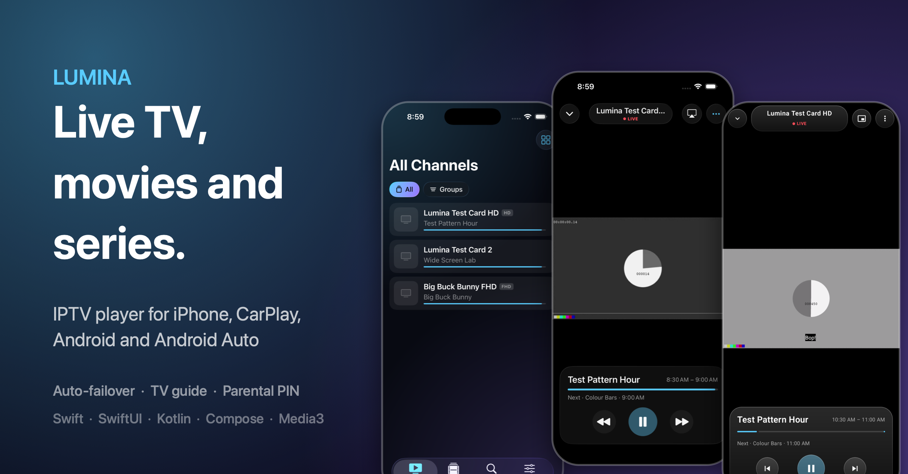
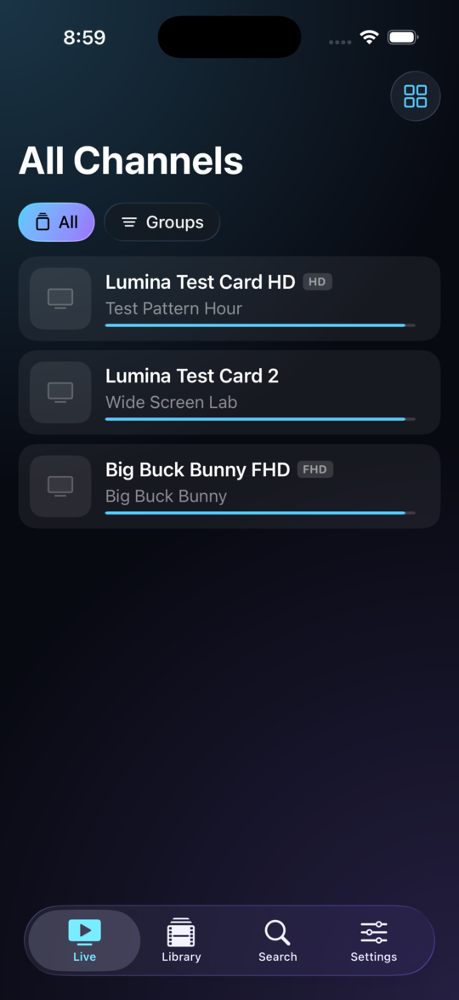
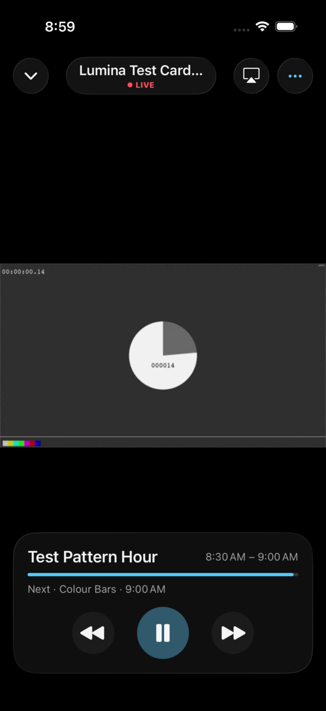
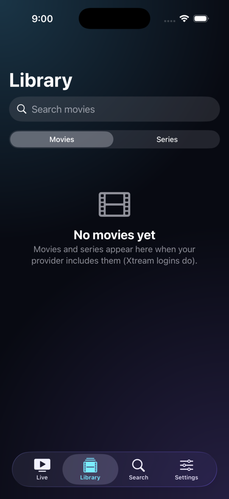
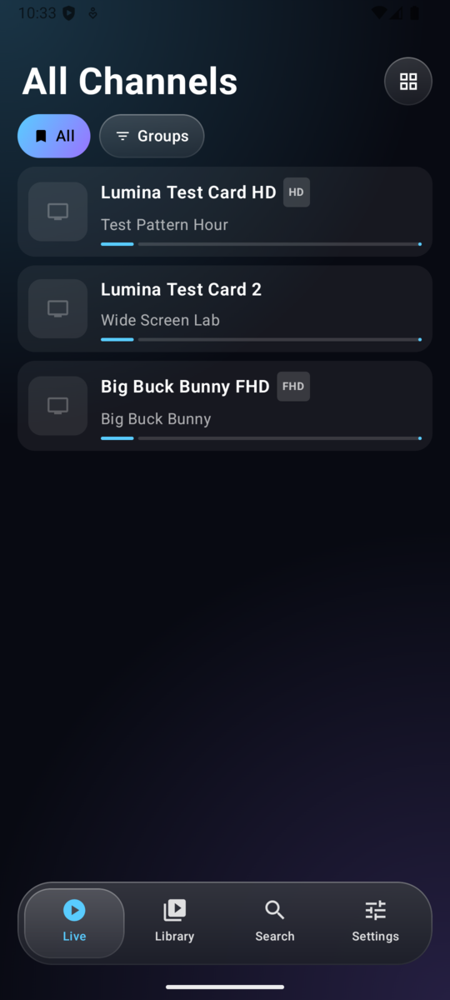
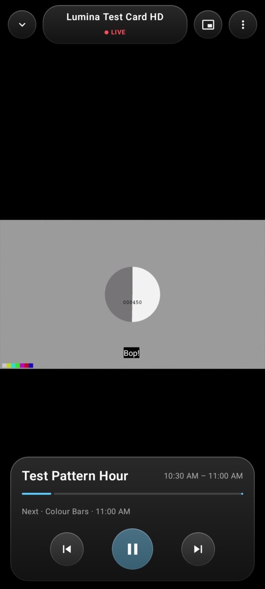
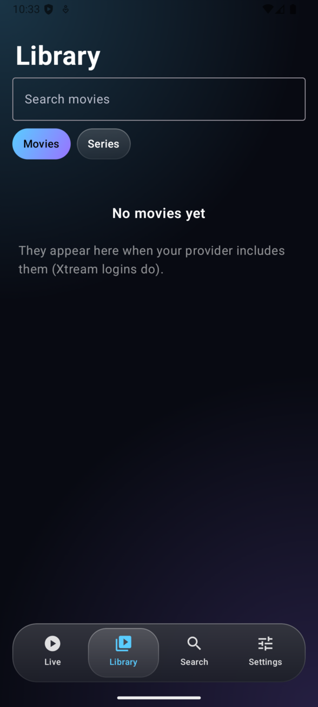

# Lumina



**An IPTV player for iPhone + CarPlay and Android + Android Auto.** Live TV with a TV guide, movies and series, one
search box, automatic failover to backup streams, parental PIN, and a calm Liquid-Glass-style interface.
Native Swift/SwiftUI on iOS, Kotlin/Jetpack Compose on Android, with the same logic written and tested in both.

[](https://github.com/niranjan6030/lumina-iptv/actions/workflows/ios-build.yml)
[](https://github.com/niranjan6030/lumina-iptv/actions/workflows/android-build.yml)

| iPhone | | | Android | | |
|---|---|---|---|---|---|
|  |  |  |  |  |  |

> **Lumina is only a player.** It contains no channels, playlists or content. The demo source uses public Apple/Mux
> test streams. Add playlists from a provider you have the right to use. Not affiliated with Apple, Google or any
> IPTV service or app.

Native Swift / SwiftUI on iPhone. Liquid Glass on iOS 26, graceful material fallback on iOS 17–25.

## Status — what has and hasn't been verified

| Part | Verified how |
|---|---|
| `Packages/LuminaCore` (parsing, guide, Xtream, search, failover helpers, user data) | 29 automated tests, run locally and in CI (`scripts/test-core.sh`) |
| Whole iOS app incl. CarPlay scene | **Compiles with Xcode 26.6** on GitHub Actions (`.github/workflows/ios-build.yml`), no errors |
| Phone UI + player | Launched in the iOS Simulator in CI with the demo source: Live list with now/next, player with live video and controls, Library, Search, Settings. Screenshots are attached to each CI run (artifact `screenshots`) |
| CarPlay scene | Compiles. **Not yet run**: needs the Simulator's CarPlay window (Xcode) or a car |
| Real providers (Xtream/M3U), PiP, AirPlay, reminders | Not tested yet (no provider available in CI) |

## Install on your iPhone for free
No paid account needed: see [docs/SIDELOAD.md](docs/SIDELOAD.md) (free Apple ID + Sideloadly/AltStore; renew every 7 days; no CarPlay).
With a paid account and TestFlight instead: [docs/TESTFLIGHT.md](docs/TESTFLIGHT.md).

## Setup (once)

1. Install **Xcode 26+** from the App Store, open it once, accept the licence.
2. `brew install xcodegen`
3. Edit `Config/Signing.xcconfig`: set `DEVELOPMENT_TEAM` (and change `LUMINA_BUNDLE_ID` if you like).
4. `xcodegen generate` → open `Lumina.xcodeproj` → run on your iPhone or a simulator.
5. First launch → **Try the demo first** to confirm playback works, then add your provider.

## CarPlay

* **Simulator (works today, no Apple approval needed):** run the app, then in the Simulator menu
  *I/O → External Displays → CarPlay*. Open Lumina on the CarPlay screen.
* **Real car:** Apple must grant a CarPlay entitlement to your developer account.
  1. Request it at <https://developer.apple.com/contact/carplay/> (paid Developer Program required).
  2. Suggested wording: *"Live TV and radio player for user-supplied playlists. Browse favorites/recents/groups,
     search, play with Now Playing controls (next/previous channel). Audio-only playback while driving."*
     Ask for **CarPlay Audio**, and also the **CarPlay Video** category if Apple's form offers it.
  3. When approved, in `Config/Signing.xcconfig` set `LUMINA_DEVICE_ENTITLEMENTS = App/Lumina.entitlements`,
     enable the capability on your App ID, re-run `xcodegen generate`, rebuild to the phone.
* Approval is Apple's decision and can take days or be declined for the audio category. Video on the car screen
  only works in cars that support "video in car", and (per Apple) only while parked; otherwise it falls back to audio.
  **CarPlay video is not implemented yet** — it needs the entitlement and Xcode's CarPlay headers to build against.

### What the CarPlay scene does
Tabs: Favorites · Recent · Browse (search + groups). Tap a channel → Now Playing with next/previous channel and a
favorite button. Audio-only by default (setting). Lists are capped and updated in place, artwork is 120 px and lazy.

## Features

Playlists: M3U/M3U8 links, files (also "Open in Lumina" from Files/Safari), Xtream Codes login. Pasting a provider's
`get.php?username=…` link auto-switches to the Xtream API.
Live TV: groups with region filter, favorites, recents, list/grid, now/next with progress, per-channel schedule,
catch-up/replay (Xtream timeshift + common M3U catch-up styles), reminders (local notifications), quality badges.
Playback: shared player for phone/lock screen/AirPlay/CarPlay, Picture in Picture, audio/subtitle track menu,
audio-only mode, sleep timer with fade, swipe up/down to change channel, resume where you left off.
Library: movies, series (seasons/episodes, auto-play next), continue watching, Xtream details.
Search: one box for channels, programmes airing in the next 36 h, movies and series.
Guide: XMLTV (plain or `.gz`), per-source time shift, extra guide URLs, cached for instant start.
Beyond the usual: **automatic failover to backup streams**, **duplicate-channel merging** (ESPN / ESPN HD / ESPN FHD
become one channel with fallbacks), **dead-channel scan**, parental PIN with per-group locks (also enforced in CarPlay),
adult-group hiding, backup/restore, friendly error messages.


## Android + Android Auto (`android/`)

Kotlin, Jetpack Compose, Media3/ExoPlayer. Same features and design as the iPhone app. ExoPlayer also plays raw MPEG-TS,
so providers that only offer `.ts` work here.

| Part | Verified how |
|---|---|
| `android/core` (parsers, guide, Xtream, search, merge, catch-up, user data) | 26 JUnit tests incl. mock Xtream panel and end-to-end HTTP + gzip guide (`./gradlew :core:test`) |
| App UI + player | Built and run on an Android 16 emulator: Live (now/next), player with controls and live HLS video, Library, Search, Settings (screenshots below in CI notes) |
| Android Auto media service | Instrumented test connects as a real `MediaBrowser` (what a car does): browse tree Favorites/Recent/Groups, search, id-only play starts, browsed list becomes the zapping queue |
| Automatic failover | Instrumented test: dead FHD stream + good backup from a second provider merge into one channel, playback recovers by itself |
| Not yet verified | A real car or the Desktop Head Unit, real providers, Picture-in-Picture UX, reminders |

Build & run:
```bash
cd android
./gradlew :core:test :app:assembleDebug            # APK: app/build/outputs/apk/debug/app-debug.apk
./gradlew :app:connectedDebugAndroidTest           # needs a running emulator/device
```
Android Studio isn't required (JDK 21 + Android SDK is enough). Sideload the APK, then for Android Auto: Android Auto settings →
tap *Version* 10 times → Developer settings → enable **Unknown sources**; Lumina then shows up in the car's media apps.
Android Auto only allows audio from third-party media apps, so the car plays the channel audio (video stays on the phone).

## Known limits (honest list)
* AVPlayer cannot play raw MPEG-TS over HTTP. Xtream-style `.ts` links are tried as `.m3u8` first. Providers that only
  offer raw TS will fail until an FFmpeg/VLC engine is added behind `PlayerController` (planned seam).
* No full multi-channel timeline grid yet (per-channel schedule only).
* No iCloud sync (needs a capability); use Backup/Restore.
* Xtream passwords are stored in the app's sandbox, not the Keychain (yet).

## Layout
```
Packages/LuminaCore/   pure Swift logic + tests (runs on macOS without Xcode)
App/Model/             AppModel (library, guide, user data), PlayerController, image loader
App/UI/                SwiftUI screens
App/CarPlay/           CarPlay scene + templates
Config/Signing.xcconfig, project.yml (XcodeGen), scripts/
```

## License
MIT, see [LICENSE](LICENSE).
